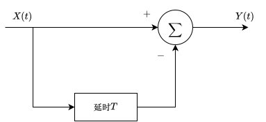

# 随机变量的统计关系

## 独立性、正交性与不相关性

三者从不同层面描述两个随机变量 $X$、$Y$ 的关系；独立性看整体分布，正交性看乘积的均值，不相关性看去掉均值后的波动关系。

### 独立性

- **定义**：已知一个变量的取值，不改变另一个变量的概率分布。

- **判据（离散）**
  $$
  P(X=x,\;Y=y)=P(X=x)\,P(Y=y)
  $$
  
- **判据（连续）**
  $$
  f_{XY}(x,y)=f_X(x)\,f_Y(y)
  $$
  
- **判断方法**：联合分布能写成两个边缘分布的乘积，则独立。

### 正交性

- **定义**：两个随机变量乘积的期望为 0。

- **公式**
  $$
  E[XY]=0
  $$
  **注意**：正交只约束 $E[XY]$，不要求 $E[X]=0$ 或 $E[Y]=0$。

### 不相关性

- **定义**：两个随机变量去掉均值后的波动部分不再同向或反向变化。

- **公式**
  $$
  \operatorname{Cov}(X,Y)=E\big[(X-E[X])(Y-E[Y])\big]=0
  $$
  
- **等价判据**
  $$
  E[XY]=E[X]\,E[Y]
  $$

- **相关系数判据**
  $$
  \rho_{XY}=\frac{\operatorname{Cov}(X,Y)}{\sigma_X\sigma_Y}=0
  $$

### 区别与联系

| 关系 | 数学条件 | 关注点 |
|---|---|---|
| 独立 | $f_{XY}(x,y)=f_X(x)f_Y(y)$ | 整个联合分布 |
| 不相关 | $\operatorname{Cov}(X,Y)=0$ | 二阶中心矩 |
| 正交 | $E[XY]=0$ | 二阶原点矩 |

### 示例

设 $X$ 等概率取 $-1,0,1$，令 $Y=X^2$。

- **求均值**
  $$
  E[X]=\frac{-1+0+1}{3}=0
  $$
  $$
  E[Y]=E[X^2]=\frac{1+0+1}{3}=\frac{2}{3}
  $$

- **求乘积期望**
  $$
  E[XY]=E[X^3]=\frac{-1+0+1}{3}=0
  $$

- **判断相关性**
  
  因为
  $$
  E[XY]=0=E[X]E[Y]
  $$
  所以 $X$ 与 $Y$ 不相关；又因为 $E[XY]=0$，两者也正交。
  
- **判断独立性**
  $$
  P(X=0,\;Y=0)=\frac{1}{3}
  $$
  而
  $$
  P(X=0)P(Y=0)=\frac{1}{3}\cdot\frac{1}{3}=\frac{1}{9}
  $$
  两者不相等，所以 $X$ 与 $Y$ 不独立。

- **结论**：

  1. 独立一定不相关；
  2. 不相关不一定独立；
  3. 零均值时不相关与正交重合。

# 随机过程的概率描述

## 一维概率密度函数

- **定义**：对固定时刻 $t$，$X(t)$ 是一个随机变量，其概率密度记为 $f_X(x;t)$。

- **归一化条件**
  $$
  \int_{-\infty}^{+\infty} f_X(x;t)\,dx=1
  $$
  其中积分对 $x$ 进行，$t$ 在该积分中视为常数。

### 变量代换法

已知随机变量 $A$ 的密度 $f_A(a)$，且 $X(t)=g(A,t)$，通过函数关系把 $f_A(a)$ 换算为 $f_X(x;t)$ 。

- **公式**
  $$
  f_X(x;t)=f_A\big(h(x,t)\big)\left|\frac{\partial h(x,t)}{\partial x}\right|
  $$
  其中 $h(x,t)$ 是 $x=g(a,t)$ 的反函数，即 $a=h(x,t)$；$\left|\partial h/\partial x\right|$ 是反函数导数的绝对值。

- **示例**

  设随机变量 $A\sim U(0,1)$，定义随机过程
  $$
  X(t)=-\frac{\ln A}{t},\ t>0
  $$
  求 $X(t)$ 的一维概率密度 $f_X(x;t)$。

  将 $x$ 看作关于 $a$ 的函数，有
  $$
  x=-\frac{\ln a}{t}
  $$
  由此可以求出
  $$
  a=e^{-tx}
  $$
  对 $a$ 求 $x$ 的导数，并取绝对值，有
  $$
  \left|\frac{da}{dx}\right|=te^{-tx}
  $$
  又因为 $A\sim U(0,1)$，所以
  $$
  f_A(a)=1
  $$
  得到
  $$
  f_X(x;t)=1\cdot te^{-tx}=te^{-tx}
  $$
  因为
  $$
  0<a<1\Rightarrow0<e^{-tx}<1
  $$
  且 $t>0$，所以 $x>0$，最终有
  $$
  f_X(x;t)=
  \begin{cases}
  te^{-tx},\ & x>0 \\
  0,\ & x\le0
  \end{cases}
  $$

## 随机过程的数字特征

### 均值函数

- **定义**：固定时刻 $t$，$X(t)$ 的数学期望称为均值函数。
  $$
  m_X(t)=E[X(t)]
  $$
  
- **公式**
  $$
  m_X(t)=\int_{-\infty}^{+\infty} x\,f_X(x;t)\,dx
  $$
  
- **性质**
  - **线性性**
    $$
    E[aX(t)+bY(t)]=aE[X(t)]+bE[Y(t)]
    $$
    其中 $a$、$b$ 为常数。
  - **随机变量乘确定函数**
    $$
    E[A\,g(t)]=E[A]\,g(t)
    $$
    其中 $A$ 为随机变量，$g(t)$ 为确定函数。
  - **均值平稳**：$m_X(t)$ 为常数时，过程具有均值平稳性。

- **示例**

  设 $X(t)=-\dfrac{\ln A}{t}$，$A\sim U(0,1)$，$t>0$，且
  $$
  f_X(x;t)=t e^{-tx},\qquad x>0
  $$
  求 $m_X(t)$。

  用密度积分：
  $$
  m_X(t)=\int_0^{+\infty} x\cdot t e^{-tx}\,dx
  $$
  分部积分，令 $u=x$、$dv=t e^{-tx}dx$，则 $v=-e^{-tx}$：
  $$
  \begin{aligned}
  m_X(t)
  &=\left[-x e^{-tx}\right]_0^{+\infty}
  +\int_0^{+\infty} e^{-tx}\,dx \\
  &=0+\frac{1}{t} \\
  &=\frac{1}{t}
  \end{aligned}
  $$
  也可直接计算：
  $$
  m_X(t)=E\left[-\frac{\ln A}{t}\right]
  =-\frac{1}{t}E[\ln A]
  =-\frac{1}{t}\cdot(-1)
  =\frac{1}{t}
  $$
  其中
  $$
  E[\ln A]=\int_0^1 \ln a\,da=-1
  $$

- **结论**：均值函数是固定时刻后对 $X(t)$ 求期望得到的确定函数，描述过程在每个时刻的平均水平。

### 方差函数

- **定义**：固定时刻 $t$，$X(t)$ 围绕均值 $m_X(t)$ 的波动程度。
  $$
  D_X(t)=E\left[\big(X(t)-m_X(t)\big)^2\right]
  $$
  
- **常用公式**
  $$
  D_X(t)=E[X^2(t)]-\big(m_X(t)\big)^2
  $$
  
- **用密度计算**
  $$
  D_X(t)=\int_{-\infty}^{+\infty}\big(x-m_X(t)\big)^2 f_X(x;t)\,dx
  $$
  
- **性质**
  - **非负性**
    $$
    D_X(t)\ge 0
    $$
    方差是平方的期望，不可能为负。
  - **加常数不变**
    $$
    D[X(t)+c]=D[X(t)]
    $$
    其中 $c$ 为常数；整体平移不改变波动大小。
  - **乘常数平方**
    $$
    D[aX(t)]=a^2D[X(t)]
    $$
  - **随机变量乘确定函数**
    $$
    D[A\,g(t)]=D[A]\,g^2(t)
    $$
  - **标准差**
    $$
    \sigma_X(t)=\sqrt{D_X(t)}
    $$
  
- **示例**

  设 $X(t)=-\dfrac{\ln A}{t}$，$A\sim U(0,1)$，$t>0$，且
  $$
  m_X(t)=\frac{1}{t}
  $$
  求 $D_X(t)$。

  先求均方值：
  $$
  E[X^2(t)]=\int_0^{+\infty}x^2\cdot t e^{-tx}\,dx
  $$
  利用
  $$
  \int_0^{+\infty}x^n e^{-tx}\,dx=\frac{n!}{t^{n+1}}
  $$
  取 $n=2$，得
  $$
  E[X^2(t)]=t\cdot\frac{2}{t^3}=\frac{2}{t^2}
  $$

  也可由 $X(t)=-\dfrac{\ln A}{t}$ 直接验证：
  $$
  X^2(t)=\frac{(\ln A)^2}{t^2}
  $$
  所以
  $$
  E[X^2(t)]=\frac{1}{t^2}E\big[(\ln A)^2\big]
  $$
  而
  $$
  E\big[(\ln A)^2\big]=\int_0^1(\ln a)^2\,da=2
  $$
  因此
  $$
  E[X^2(t)]=\frac{2}{t^2}
  $$
  与积分结果一致。

  所以
  $$
  D_X(t)=E[X^2(t)]-\big(m_X(t)\big)^2
  =\frac{2}{t^2}-\frac{1}{t^2}
  =\frac{1}{t^2}
  $$

  也可直接用方差性质：
  $$
  D_X(t)=D\left[-\frac{1}{t}\ln A\right]
  =\frac{1}{t^2}D[\ln A]
  $$
  而
  $$
  D[\ln A]=E\big[(\ln A)^2\big]-\big(E[\ln A]\big)^2
  =2-(-1)^2=1
  $$
  所以
  $$
  D_X(t)=\frac{1}{t^2}
  $$

- **结论**：方差函数等于均方值减均值平方，描述随机过程在每个时刻围绕均值的波动程度。

### 相关函数

- **定义**：随机过程在两个不同时刻取值的平均乘积，称为自相关函数。
  $$
  R_X(t_1,t_2)=E\big[X(t_1)X(t_2)\big]
  $$
  
- **与均方值的关系**
  $$
  R_X(t,t)=E[X^2(t)]=\psi_X^2(t)
  $$
  
- **与协方差函数的关系**
  $$
  C_X(t_1,t_2)=R_X(t_1,t_2)-m_X(t_1)m_X(t_2)
  $$
  
- **零均值情形**
  $$
  m_X(t)=0
  \quad\Longrightarrow\quad
  C_X(t_1,t_2)=R_X(t_1,t_2)
  $$

- **性质**
  - **对称性**
    $$
    R_X(t_1,t_2)=R_X(t_2,t_1)
    $$
    实过程的乘积交换顺序不变。
  - **有界性**
    $$
    \big|R_X(t_1,t_2)\big|
    \le\sqrt{R_X(t_1,t_1)\,R_X(t_2,t_2)}
    $$
    这是柯西—施瓦茨不等式给出的上界。

- **示例**

  设 $A\sim U(0,1)$，随机过程为
  $$
  X(t)=A t
  $$
  求 $R_X(t_1,t_2)$。

  两个时刻的乘积为
  $$
  X(t_1)X(t_2)=A^2t_1t_2
  $$
  所以
  $$
  R_X(t_1,t_2)=E[A^2t_1t_2]=t_1t_2E[A^2]
  $$
  而
  $$
  E[A^2]=\int_0^1a^2\,da=\frac{1}{3}
  $$
  因此
  $$
  R_X(t_1,t_2)=\frac{t_1t_2}{3}
  $$

  令 $t_1=t_2=t$，得
  $$
  R_X(t,t)=\frac{t^2}{3}
  $$
  与
  $$
  E[X^2(t)]=E[A^2t^2]=\frac{t^2}{3}
  $$
  一致。

  均值函数为
  $$
  m_X(t)=E[At]=\frac{t}{2}
  $$
  所以协方差函数为
  $$
  \begin{aligned}
  C_X(t_1,t_2)
  &=R_X(t_1,t_2)-m_X(t_1)m_X(t_2) \\
  &=\frac{t_1t_2}{3}-\frac{t_1t_2}{4} \\
  &=\frac{t_1t_2}{12}
  \end{aligned}
  $$
  当 $t_1=t_2=t$ 时，$C_X(t,t)=t^2/12$，正好等于方差 $D_X(t)$。

### 协方差函数

- **定义**：两个时刻的波动量乘积的期望。
  $$
  C_X(t_1,t_2)=E\left[\big(X(t_1)-m_X(t_1)\big)\big(X(t_2)-m_X(t_2)\big)\right]
  $$
  
- **与相关函数的关系**
  $$
  C_X(t_1,t_2)=R_X(t_1,t_2)-m_X(t_1)m_X(t_2)
  $$
  
- **反向关系**
  $$
  R_X(t_1,t_2)=C_X(t_1,t_2)+m_X(t_1)m_X(t_2)
  $$

- **与方差的关系**
  $$
  C_X(t,t)=E\left[\big(X(t)-m_X(t)\big)^2\right]=D_X(t)
  $$
  
- **零均值情形**
  $$
  m_X(t)=0
  \quad\Longrightarrow\quad
  C_X(t_1,t_2)=R_X(t_1,t_2)
  $$

- **性质**
  - **对称性**
    $$
    C_X(t_1,t_2)=C_X(t_2,t_1)
    $$
    
  - **不相关**
    $$
    C_X(t_1,t_2)=0
    $$
    表示两个时刻的波动部分没有线性关联。
    
  - **有界性**
    $$
    \big|C_X(t_1,t_2)\big|\le\sigma_X(t_1)\sigma_X(t_2)
    $$
    其中 $\sigma_X(t)=\sqrt{D_X(t)}$ 为标准差。
    
  - **归一化相关系数**
    $$
    \rho_X(t_1,t_2)=\frac{C_X(t_1,t_2)}{\sigma_X(t_1)\sigma_X(t_2)}
    $$
    其中 $|\rho_X(t_1,t_2)|\le 1$。
  
- **示例**

  沿用指数过程：
  $$
  X(t)=-\frac{\ln A}{t},\qquad A\sim U(0,1),\quad t>0
  $$
  前面已求得
  $$
  m_X(t)=\frac{1}{t},\qquad D_X(t)=\frac{1}{t^2}
  $$

  先求相关函数：
  $$
  X(t_1)X(t_2)=\frac{(\ln A)^2}{t_1t_2}
  $$
  所以
  $$
  R_X(t_1,t_2)
  =\frac{1}{t_1t_2}E\big[(\ln A)^2\big]
  $$
  而
  $$
  E\big[(\ln A)^2\big]=\int_0^1(\ln a)^2\,da=2
  $$
  因此
  $$
  R_X(t_1,t_2)=\frac{2}{t_1t_2}
  $$

  再算协方差函数：
  $$
  \begin{aligned}
  C_X(t_1,t_2)
  &=R_X(t_1,t_2)-m_X(t_1)m_X(t_2) \\
  &=\frac{2}{t_1t_2}-\frac{1}{t_1t_2} \\
  &=\frac{1}{t_1t_2}
  \end{aligned}
  $$

  令 $t_1=t_2=t$，得
  $$
  C_X(t,t)=\frac{1}{t^2}=D_X(t)
  $$
  结果一致。

  相关系数为
  $$
  \rho_X(t_1,t_2)
  =\frac{\frac{1}{t_1t_2}}{\frac{1}{t_1}\cdot\frac{1}{t_2}}
  =1
  $$
  说明两个时刻的取值完全正相关，因为它们都由同一个随机变量 $A$ 决定。

- **结论**：协方差函数等于相关函数减去均值乘积，描述两个时刻波动部分的关联；对角线上的值就是方差函数。

# 平稳性

## 严格平稳过程

时间轴整体平移后，任意有限个时刻的联合统计规律都不变。

- **一维特例**
  $$
  f_X(x;t)=f_X(x)
  $$
  一维概率密度与 $t$ 无关，因此均值和方差（若存在）都是常数。

- **二维特例**
  $$
  f_X(x_1,x_2;t_1,t_2)=f_X(x_1,x_2;0,t_2-t_1)
  $$
  二维分布只依赖时间差 $\tau=t_2-t_1$，因此自相关函数也只依赖 $\tau$：
  $$
  R_X(t_1,t_2)=R_X(\tau),\qquad \tau=t_2-t_1
  $$

- **示例**

  设
  $$
  X(t)=A\cos(\omega t+\Theta)
  $$
  其中 $A$、$\omega$ 为常数，$\Theta\sim U(0,2\pi)$。时间平移只改变相位，不改变相位的均匀性，所以任意维联合分布都不随时间起点变化，$X(t)$ 是严格平稳过程。

  设
  $$
  X(t)=At,\qquad A\sim U(0,1)
  $$
  在 $t=0$ 时 $X(0)=0$，分布退化为一个点；在 $t=1$ 时 $X(1)=A$，在 $(0,1)$ 上均匀分布。两个时刻的一维分布不同，所以 $X(t)$ 不是严格平稳过程。

- **结论**：严格平稳要求任意维联合分布对时间平移不变，是最强的平稳性；它保证一维分布不随时间变、二维分布只依赖时间差。

### 正态过程的严格平稳性

设 $A$、$B$ 相互独立，且都服从标准正态分布：
$$
A\sim N(0,1),\qquad B\sim N(0,1)
$$
定义
$$
X(t)=A\cos(\omega t)+B\sin(\omega t)
$$

对任意时刻 $t_1,\dots,t_n$，向量
$$
\big(X(t_1),\dots,X(t_n)\big)
$$
是 $(A,B)$ 的线性变换。正态变量的线性变换仍是正态的，所以 $X(t)$ 是正态过程。

均值为
$$
E[X(t)]=E[A]\cos(\omega t)+E[B]\sin(\omega t)=0
$$
自相关函数为
$$
\begin{aligned}
R_X(t_1,t_2)
&=E[A^2]\cos(\omega t_1)\cos(\omega t_2)
+E[B^2]\sin(\omega t_1)\sin(\omega t_2) \\
&=\cos(\omega t_1)\cos(\omega t_2)
+\sin(\omega t_1)\sin(\omega t_2) \\
&=\cos\big(\omega(t_1-t_2)\big)
\end{aligned}
$$
均值是常数，自相关只依赖 $t_2-t_1$，所以广义平稳。

因为 $X(t)$ 是正态过程且广义平稳，所以它一定严格平稳。

## 广义平稳过程

- **定义**：均值恒定、自相关函数只依赖时间差且二阶矩有限的过程，称为广义平稳过程，也称宽平稳过程。

- **条件**
  
  1. **均值为常数**
     $$
     m_X(t)=m_X
     $$
  2. **自相关函数只依赖时间差**
     $$
     R_X(t_1,t_2)=R_X(t_2-t_1)=R_X(\tau)
     $$
  3. 二阶矩有限
     $$
     E[X^2(t)]<+\infty
     $$

- **示例**

  设随机过程 $Z(t)=X\cos(t)+Y\sin(t),\ -\infty<t<+\infty$。其中 $X,\ Y$ 为相互独立的随机变量，且分别以概率 $\frac{2}{3},\ \frac{1}{3}$ 取值 $-1$ 和 $2$。讨论随机过程 $Z(t)$ 是否广义平稳和严格平稳。

  - **求均值**

    $$
    E[X]=E[Y]=(-1)\cdot\frac{2}{3}+2\cdot\frac{1}{3}=0
    $$

    $$
    E[Z(t)]=E[X]\cos t+E[Y]\sin t=0
    $$

    均值为常数 0。

  - **求自相关函数**

    $$
    \begin{aligned}
    R_Z(t_1,t_2)
    &=E\big[(X\cos t_1+Y\sin t_1)(X\cos t_2+Y\sin t_2)\big] \\
    &=E[X^2]\cos t_1\cos t_2
    +E[Y^2]\sin t_1\sin t_2 \\
    &\quad +E[XY](\cos t_1\sin t_2+\sin t_1\cos t_2)
    \end{aligned}
    $$

    其中

    $$
    E[X^2]=E[Y^2]=(-1)^2\cdot\frac{2}{3}+2^2\cdot\frac{1}{3}=2
    $$

    又因为 $X$、$Y$ 相互独立且均值为 0，

    $$
    E[XY]=E[X]E[Y]=0
    $$

    所以

    $$
    \begin{aligned}
    R_Z(t_1,t_2)
    &=2\cos t_1\cos t_2+2\sin t_1\sin t_2 \\
    &=2\cos(t_1-t_2)
    \end{aligned}
    $$

    只依赖时间差 $\tau=t_2-t_1$。

  - **判断广义平稳**

    均值为常数，自相关函数只依赖时间差，且

    $$
    E[Z^2(t)]=R_Z(t,t)=2<+\infty
    $$

    所以 $Z(t)$ 是广义平稳过程。

  - **判断严格平稳**

    取 $t=0$：

    $$
    Z(0)=X
    $$

    因此

    $$
    P\big(Z(0)=-1\big)=\frac{2}{3},\qquad
    P\big(Z(0)=2\big)=\frac{1}{3}
    $$

    取 $t=\dfrac{\pi}{4}$：

    $$
    Z\left(\frac{\pi}{4}\right)=\frac{X+Y}{\sqrt{2}}
    $$

    $X+Y$ 的分布为

    $$
    P(X+Y=-2)=\frac{4}{9},\qquad
    P(X+Y=1)=\frac{4}{9},\qquad
    P(X+Y=4)=\frac{1}{9}
    $$

    所以 $Z\left(\frac{\pi}{4}\right)$ 以概率 $\frac{4}{9}$、$\frac{4}{9}$、$\frac{1}{9}$ 分别取 $-\sqrt{2}$、$\dfrac{\sqrt{2}}{2}$、$2\sqrt{2}$。

    两个时刻的一维分布不同，所以 $Z(t)$ 不是严格平稳过程。

### 与严格平稳的关系

- **严格平稳 $\Rightarrow$ 广义平稳**：当二阶矩存在时成立。
  - 一维分布 $f_X(x;t)=f_X(x)$ 与时间无关，所以均值为常数。
  - 二维分布只依赖 $\tau=t_2-t_1$，所以自相关函数只依赖 $\tau$。
  - 二阶矩存在保证均值和自相关都有定义。

- **广义平稳 $\nRightarrow$ 严格平稳**：广义平稳只约束前两阶矩，不能保证高阶分布也不随时间起点变化。

- **正态过程**：若 $X(t)$ 为正态过程，则任意维联合分布由均值函数和自相关函数完全确定，因此
  $$
  \text{广义平稳}
  \quad\Longleftrightarrow\quad
  \text{严格平稳}
  $$
  
- **结论**：严格平稳是分布层面的要求，广义平稳只是二阶矩层面的要求；一般情况下严格平稳更强，正态过程使两者等价。

## 联合广义平稳过程

### 判定条件

- **定义**：两个随机过程各自广义平稳，且它们的互相关函数只依赖时间差，则称二者为联合广义平稳过程。

- **条件**
  1. **$X(t)$ 广义平稳**
     $$
     m_X(t)=m_X,\qquad R_X(t_1,t_2)=R_X(\tau)
     $$
  2. $Y(t)$ 广义平稳
     $$
     m_Y(t)=m_Y,\qquad R_Y(t_1,t_2)=R_Y(\tau)
     $$
  3. **互相关函数只依赖时间差**
     $$
     R_{XY}(t_1,t_2)=E\big[X(t_1)Y(t_2)\big]=R_{XY}(\tau)
     $$
  
- **互协方差函数**
  $$
  C_{XY}(t_1,t_2)
  =E\left[\big(X(t_1)-m_X\big)\big(Y(t_2)-m_Y\big)\right]
  $$
  展开得
  $$
  C_{XY}(t_1,t_2)=R_{XY}(t_1,t_2)-m_Xm_Y
  $$
  当 $m_X$、$m_Y$ 为常数时，$R_{XY}$ 与 $C_{XY}$ 只依赖 $\tau$ 的条件等价。

- **性质**
  - **互相关一般不是偶函数**
    $$
    R_{XY}(\tau)\neq R_{XY}(-\tau)
    $$
  - **反向互相关**
    $$
    R_{YX}(\tau)=R_{XY}(-\tau)
    $$
    其中 $R_{YX}(\tau)=E[Y(t_1)X(t_2)]$。
  - **独立情形**：若 $X(t)$、$Y(t)$ 相互独立且各自广义平稳，则
    $$
    R_{XY}(t_1,t_2)=E[X(t_1)]E[Y(t_2)]=m_Xm_Y
    $$
    结果与时间无关，因此二者联合广义平稳。

- **结论**：联合广义平稳要求两个过程各自广义平稳，并且互相关函数只依赖时间差；互相关函数一般不满足偶对称性。

## 自相关函数的性质

### 对称性

- **定义**：实广义平稳过程的自相关函数只与时间差有关，记为
  $$
  R_X(\tau)=E\big[X(t)X(t+\tau)\big]
  $$
  其中 $t$ 为任意时刻，$\tau$ 为时间差。

- **公式**
  $$
  R_X(\tau)=R_X(-\tau)
  $$
  即 $R_X(\tau)$ 是偶函数，图形关于 $\tau=0$ 对称。

- **证明**

  由定义，
  $$
  R_X(-\tau)=E\big[X(t)X(t-\tau)\big]
  $$
  令 $s=t-\tau$，则 $t=s+\tau$，代入得
  $$
  R_X(-\tau)=E\big[X(s+\tau)X(s)\big]=R_X(\tau)
  $$
  所以自相关函数是偶函数。

- **示例**

  设
  $$
  R_X(\tau)=4e^{-2|\tau|}
  $$
  则
  $$
  R_X(-\tau)=4e^{-2|-\tau|}=4e^{-2|\tau|}=R_X(\tau)
  $$
  满足对称性。

  设
  $$
  R_X(\tau)=3\cos(2\tau)
  $$
  则
  $$
  R_X(-\tau)=3\cos(-2\tau)=3\cos(2\tau)=R_X(\tau)
  $$
  同样满足对称性。

- **不满足对称性的函数**

  设
  $$
  R(\tau)=e^{-\tau}u(\tau)
  $$
  其中 $u(\tau)$ 为单位阶跃函数。当 $\tau<0$ 时 $R(\tau)=0$，当 $\tau>0$ 时 $R(\tau)=e^{-\tau}$，因此
  $$
  R(\tau)\neq R(-\tau)
  $$
  它不能作为实广义平稳过程的自相关函数。

- **注意**
  - 实过程满足 $R_X(\tau)=R_X(-\tau)$。
  - 复过程满足共轭对称：
    $$
    R_X(\tau)=R_X^*(-\tau)
    $$
    其中 $R_X^*$ 为复共轭。
  - 互相关函数一般不具有偶对称性。

- **结论**：实广义平稳过程的自相关函数是偶函数，满足 $R_X(\tau)=R_X(-\tau)$；该性质来自自相关只依赖时间间隔长度。

### $\tau=0$ 处的极值

- **结论**：实广义平稳过程的自相关函数满足
  $$
  \big|R_X(\tau)\big|\le R_X(0)
  $$
  
- **$\tau=0$ 的含义**
  $$
  R_X(0)=E[X^2(t)]=\psi_X^2
  $$
  
- **与均值、方差的关系**
  $$
  R_X(0)=D_X+m_X^2
  $$
  
- **示例**

  设
  $$
  R_X(\tau)=4e^{-2|\tau|}
  $$
  则
  $$
  R_X(0)=4,\qquad \big|R_X(\tau)\big|=4e^{-2|\tau|}\le 4
  $$

  设
  $$
  R_X(\tau)=2\cos(\omega\tau)
  $$
  则
  $$
  R_X(0)=2,\qquad \big|R_X(\tau)\big|=2|\cos(\omega\tau)|\le 2
  $$
  当 $\tau=\dfrac{2\pi}{\omega}$ 时，$R_X\left(\dfrac{2\pi}{\omega}\right)=2=R_X(0)$，说明最大值也可能在其他时间差处再次取到。

- **注意**
  - $R_X(0)$ 是全局最大值，$\tau=0$ 一定取到该最大值。
  - 对周期过程，其他 $\tau$ 也可能取到同样的最大值。
  - $R_X(\tau)$ 不一定随 $|\tau|$ 增大而单调下降。
  - 若 $R_X(0)=0$，则 $E[X^2(t)]=0$，过程几乎处处为 0。
  - 复过程同样满足 $\big|R_X(\tau)\big|\le R_X(0)$，且 $R_X(0)$ 为实数且非负。

### $\tau\to\infty$ 的极限

- **结论**：若过程在时间差很大时逐渐不相关，则
  $$
  \lim_{\tau\to\infty}R_X(\tau)=m_X^2
  $$
  
- **推导**

  把过程写成
  $$
  X(t)=m_X+Y(t)
  $$
  其中 $Y(t)$ 为零均值波动部分，$E[Y(t)]=0$。则
  $$
  \begin{aligned}
  R_X(\tau)
  &=E\big[X(t)X(t+\tau)\big] \\
  &=m_X^2+R_Y(\tau)
  \end{aligned}
  $$
  其中 $R_Y(\tau)=E[Y(t)Y(t+\tau)]$。若
  $$
  \lim_{\tau\to\infty}R_Y(\tau)=0
  $$
  则
  $$
  \lim_{\tau\to\infty}R_X(\tau)=m_X^2
  $$

- **示例**

  设
  $$
  X(t)=m+N(t)
  $$
  其中 $m$ 为常数，$N(t)$ 为零均值广义平稳过程，且
  $$
  R_N(\tau)=\sigma^2e^{-a|\tau|},\qquad a>0
  $$
  则
  $$
  R_X(\tau)=m^2+\sigma^2e^{-a|\tau|}
  $$
  当 $\tau\to\infty$ 时，$e^{-a|\tau|}\to 0$，所以
  $$
  \lim_{\tau\to\infty}R_X(\tau)=m^2
  $$

  设
  $$
  X(t)=A\cos(\omega t+\Theta)
  $$
  其中 $\Theta\sim U(0,2\pi)$，$A$ 与 $\Theta$ 独立，则
  $$
  R_X(\tau)=\frac{E[A^2]}{2}\cos(\omega\tau)
  $$
  该式随 $\tau$ 持续振荡，极限不存在。原因是过程含有周期分量，相关性不会随间隔增大而消失。

- **注意**
  - $\lim_{\tau\to\infty}R_X(\tau)=m_X^2$ 不是对所有广义平稳过程都成立，成立的前提是波动部分在时间差很大时逐渐不相关。
  - 存在周期分量时，极限可能不存在。
  - 若 $m_X=0$，在相关性衰减的前提下，$R_X(\tau)\to 0$。

## 自相关系数

### $\rho_X(\tau)$ 的计算

- **定义**：自相关系数是归一化后的协方差函数。
  $$
  \rho_X(\tau)=\frac{C_X(\tau)}{C_X(0)}
  $$
  
- **展开公式**
  $$
  \rho_X(\tau)=\frac{R_X(\tau)-m_X^2}{R_X(0)-m_X^2}
  =\frac{R_X(\tau)-m_X^2}{D_X}
  $$
  
- **计算步骤**
  1. 求均值 $m_X$。
  2. 求自相关函数 $R_X(\tau)$。
  3. 求方差 $D_X=R_X(0)-m_X^2$。
  4. 代入 $\rho_X(\tau)=\dfrac{R_X(\tau)-m_X^2}{D_X}$。

- **与自相关函数的区别**

  | 量 | 公式 | 特点 |
  |---|---|---|
  | 自相关函数 | $R_X(\tau)$ | 有量纲，包含均值影响 |
  | 协方差函数 | $C_X(\tau)=R_X(\tau)-m_X^2$ | 去掉均值，仍有量纲 |
  | 自相关系数 | $\rho_X(\tau)=\dfrac{C_X(\tau)}{D_X}$ | 无量纲，范围在 $[-1,1]$ |

- **性质**
  
  - **零点取值**：$\rho_X(0)=1$
  
  - **取值范围**：$\big|\rho_X(\tau)\big|\le 1$
  
  - **偶对称性**：实过程满足 $\rho_X(-\tau)=\rho_X(\tau)$
  
  - **零均值简化**
    
    $m_X=0$ 时，有
    $$
    \rho_X(\tau)=\frac{R_X(\tau)}{R_X(0)}
    $$
    
  - **与自相关函数的关系**
    $$
    R_X(\tau)=m_X^2+D_X\rho_X(\tau)
    $$
    
  - **不相关判据**：$\rho_X(\tau)=0$ 表示相隔 $\tau$ 的两个时刻不相关。
  
- **示例**

  设
  $$
  X(t)=m+N(t)
  $$
  其中 $m$ 为常数，$N(t)$ 为零均值广义平稳过程，且
  $$
  R_N(\tau)=\sigma^2e^{-a|\tau|},\qquad a>0
  $$
  求 $\rho_X(\tau)$。

  均值为
  $$
  m_X=m
  $$
  自相关函数为
  $$
  R_X(\tau)=m^2+\sigma^2e^{-a|\tau|}
  $$
  方差为
  $$
  D_X=R_X(0)-m_X^2=\sigma^2
  $$
  所以
  $$
  \begin{aligned}
  \rho_X(\tau)
  &=\frac{R_X(\tau)-m_X^2}{D_X} \\
  &=\frac{\sigma^2e^{-a|\tau|}}{\sigma^2} \\
  &=e^{-a|\tau|}
  \end{aligned}
  $$
  满足 $\rho_X(0)=1$，且 $\tau\to\infty$ 时 $\rho_X(\tau)\to 0$。

- **注意**
  - **前提**：计算前需确认过程广义平稳，否则 $\rho_X(\tau)$ 一般不能只写成 $\tau$ 的函数。
  - **退化情形**：若 $D_X=0$，过程几乎处处为常数，自相关系数没有定义。
  - **负值含义**：$\rho_X(\tau)$ 可以为负，负值表示两个时刻倾向于反向变化。
  - **端点含义**：$\rho_X(\tau)=1$ 表示完全正相关，$\rho_X(\tau)=-1$ 表示完全负相关。

## 相关时间

### 积分定义

- **定义**：相关时间用自相关系数在正时间轴上的积分定义。
  $$
  \tau_0=\int_0^{+\infty}\big|\rho_X(\tau)\big|\,d\tau
  $$
  
- **非负简化**：若 $\rho_X(\tau)\ge 0$ 对 $\tau\ge 0$ 成立，则
  $$
  \tau_0=\int_0^{+\infty}\rho_X(\tau)\,d\tau
  $$

- **几何含义**：$\tau_0$ 是 $\rho_X(\tau)$ 曲线下的等效宽度，等于一个高度为 1、面积为 $\tau_0$ 的矩形宽度。

- **物理含义**：相关时间越短，过程变化越快；相关时间越长，过程变化越慢。

- **计算步骤**
  1. **求自相关系数**：由 $R_X(\tau)$、$m_X$、$D_X$ 计算
     $$
     \rho_X(\tau)=\frac{R_X(\tau)-m_X^2}{D_X}
     $$
  2. **确定积分区间**：通常取 $\tau\ge 0$。
  3. **代入积分**：
     $$
     \tau_0=\int_0^{+\infty}\big|\rho_X(\tau)\big|\,d\tau
     $$
  4. **检查收敛性**：若积分发散，则相关时间不能按有限值处理。

- **示例**
  - **指数相关**

    设
    $$
    \rho_X(\tau)=e^{-a|\tau|},\qquad a>0
    $$
    当 $\tau\ge 0$ 时，$\rho_X(\tau)=e^{-a\tau}$，所以
    $$
    \begin{aligned}
    \tau_0
    &=\int_0^{+\infty}e^{-a\tau}\,d\tau \\
    &=\left[-\frac{1}{a}e^{-a\tau}\right]_0^{+\infty} \\
    &=\frac{1}{a}
    \end{aligned}
    $$
    由此可见，$a$ 越大，相关性衰减越快，相关时间越短。

  - **三角相关**

    设
    $$
    \rho_X(\tau)=
    \begin{cases}
    1-\dfrac{|\tau|}{T}, & |\tau|<T \\[6pt]
    0, & |\tau|\ge T
    \end{cases}
    $$
    当 $0\le\tau<T$ 时，$\rho_X(\tau)=1-\tau/T$，所以
    $$
    \begin{aligned}
    \tau_0
    &=\int_0^T\left(1-\frac{\tau}{T}\right)d\tau \\
    &=\left[\tau-\frac{\tau^2}{2T}\right]_0^T \\
    &=\frac{T}{2}
    \end{aligned}
    $$

- **注意**
  - **定义约定**：部分教材使用双边积分
    $$
    \tau_0=\int_{-\infty}^{+\infty}\big|\rho_X(\tau)\big|\,d\tau
    $$
    对偶函数而言，其结果是单边积分的 2 倍。
  - **积分发散**：纯周期过程的相关时间积分可能不收敛，例如 $\rho_X(\tau)=\cos(\omega\tau)$。
  - **负相关情形**：若 $\rho_X(\tau)$ 会变负，应使用绝对值，避免正负面积相互抵消。
  - **与带宽关系**：相关时间与带宽大致成反比，带宽越宽，相关时间越短。

# 各态历经性

## 均值各态历经

### 时间均值与集均值

- **集平均**：固定时刻 $t$，对所有样本函数求平均。
  $$
  m_X=E\big[X(t)\big]
  $$
  其中 $m_X$ 为集平均，是一个**确定的数**。

- **时间平均**：固定一条样本函数 $x(t)$，沿时间轴求平均。
  $$
  \overline{X}
  =\lim_{T\to\infty}\frac{1}{2T}\int_{-T}^{T}x(t)\,dt
  $$
  其中 $\overline{X}$ 为时间平均，仍可能随样本函数不同而不同，因此是**随机变量**。

- **均值各态历经**：若时间平均以概率 1 等于集平均，
  $$
  \overline{X}=m_X
  $$
  则称过程 $X(t)$ 是均值各态历经的。**各态历经要求时间平均退化为常数**。

- **充分条件**

  若协方差函数绝对可积，
  $$
  \int_0^{+\infty}\big|C_X(\tau)\big|\,d\tau<+\infty
  $$
  则时间平均的方差趋于 0，过程均值各态历经。

- **示例**

  - **不各态历经**

    设
    $$
    X(t)=A
    $$
    其中 $A$ 为随机变量，且
    $$
    E[A]=m,\qquad D[A]>0
    $$
    集平均为
    $$
    m_X=E[A]=m
    $$
    对任意样本函数 $x(t)=a$，时间平均为
    $$
    \overline{X}=a
    $$
    它是随机变量 $A$，一般不等于常数 $m$，所以 $X(t)$ 不是均值各态历经的。

  - **各态历经**

    设
    $$
    X(t)=m+A\cos(\omega t+\Theta)
    $$
    其中 $m$、$A$、$\omega$ 为常数，$\Theta\sim U(0,2\pi)$。集平均为
    $$
    m_X=m+AE[\cos(\omega t+\Theta)]=m
    $$
    时间平均为
    $$
    \begin{aligned}
    \overline{X}
    &=m+\lim_{T\to\infty}\frac{A}{2T}\int_{-T}^{T}\cos(\omega t+\Theta)\,dt \\
    &=m+0 \\
    &=m
    \end{aligned}
    $$
    所以 $\overline{X}=m_X$，该过程是均值各态历经的。

- **注意**
  - **随机性差异**：时间平均是随机变量，集平均是确定数。
  - **相等含义**：各态历经要求时间平均等于集平均，不是近似相等。
  - **收敛意义**：上述方差判据对应均方意义；几乎必然意义的要求更强。
  - **条件方向**：协方差绝对可积是充分条件，反过来不成立；周期过程也可能均值各态历经。
  - **前提条件**：通常先要求过程广义平稳，否则均值可能随时间变化，讨论各态历经没有意义。

## 自相关函数各态历经

### 时间自相关与集自相关

- **集自相关**：固定时间差 $\tau$，对所有样本函数求平均。
  $$
  R_X(\tau)=E\big[X(t)X(t+\tau)\big]
  $$
  其中 $R_X(\tau)$ 为**确定函数**，不含随机性。

- **时间自相关**：固定一条样本函数 $x(t)$，对时间原点 $t$ 求平均。
  $$
  \overline{R}_X(\tau)
  =\lim_{T\to\infty}\frac{1}{2T}\int_{-T}^{T}x(t)x(t+\tau)\,dt
  $$
  其中 $\tau$ 为固定时间差，积分变量为 $t$，结果仍可能随样本不同而不同，因此是**随机函数**。

- **定义**：若对任意 $\tau$，都有
  $$
  \overline{R}_X(\tau)=R_X(\tau)
  $$
  以概率 1 成立，则称过程 $X(t)$ 是自相关函数各态历经的，也称相关各态历经。

- **正态简化**：对正态过程，若
  $$
  \int_{-\infty}^{+\infty}\big|R_X(u)\big|\,du<+\infty
  $$
  则过程相关各态历经。

- **示例**
  - **不相关各态历经**

    设
    $$
    X(t)=A
    $$
    其中 $A$ 为随机变量。集自相关为
    $$
    R_X(\tau)=E[A^2]
    $$
    对样本函数 $x(t)=a$，时间自相关为
    $$
    \overline{R}_X(\tau)
    =\lim_{T\to\infty}\frac{1}{2T}\int_{-T}^{T}a^2\,dt
    =a^2
    $$
    所以 $\overline{R}_X(\tau)=A^2$，一般不等于 $E[A^2]$，因此不是相关各态历经的。

  - **相关各态历经**

    设
    $$
    X(t)=A\cos(\omega t+\Theta)
    $$
    其中 $A$、$\omega$ 为常数，$\Theta\sim U(0,2\pi)$。

    **集自相关**：
    $$
    \begin{aligned}
    R_X(\tau)
    &=E\big[A\cos(\omega t+\Theta)A\cos(\omega(t+\tau)+\Theta)\big] \\
    &=\frac{A^2}{2}E\big[\cos(\omega\tau)+\cos(2\omega t+2\Theta+\omega\tau)\big] \\
    &=\frac{A^2}{2}\cos(\omega\tau)
    \end{aligned}
    $$
    其中 $\Theta$ 在 $[0,2\pi)$ 上均匀分布，故
    $$
    E\big[\cos(2\omega t+2\Theta+\omega\tau)\big]=0
    $$

    **时间自相关**：对样本函数 $x(t)=A\cos(\omega t+\theta)$，
    $$
    \begin{aligned}
    \overline{R}_X(\tau)
    &=\lim_{T\to\infty}\frac{1}{2T}\int_{-T}^{T}
    A\cos(\omega t+\theta)A\cos(\omega(t+\tau)+\theta)\,dt \\
    &=\frac{A^2}{2}\lim_{T\to\infty}\frac{1}{2T}\int_{-T}^{T}
    \big[\cos(\omega\tau)+\cos(2\omega t+2\theta+\omega\tau)\big]dt \\
    &=\frac{A^2}{2}\cos(\omega\tau)
    +\frac{A^2}{2}\lim_{T\to\infty}\frac{1}{2T}
    \int_{-T}^{T}\cos(2\omega t+2\theta+\omega\tau)\,dt
    \end{aligned}
    $$
    令 $\varphi=2\theta+\omega\tau$，则
    $$
    \int_{-T}^{T}\cos(2\omega t+\varphi)\,dt
    =\frac{\sin(2\omega T)\cos\varphi}{\omega}
    $$
    所以
    $$
    \lim_{T\to\infty}\frac{1}{2T}\int_{-T}^{T}\cos(2\omega t+\varphi)\,dt
    =\lim_{T\to\infty}\frac{\sin(2\omega T)\cos\varphi}{2\omega T}
    =0
    $$
    因此
    $$
    \overline{R}_X(\tau)=\frac{A^2}{2}\cos(\omega\tau)
    $$

    于是
    $$
    \overline{R}_X(\tau)=R_X(\tau)
    $$
    该过程是相关各态历经的。

- **注意**
  - **随机函数**：时间自相关是 $\tau$ 的随机函数，不是确定函数。
  - **平均对象**：平均对时间原点 $t$ 进行，不是对时间差 $\tau$ 进行。
  - **逐点相等**：相关各态历经要求对每个 $\tau$ 都相等。
  - **前提条件**：通常先要求过程广义平稳，否则 $R_X$ 一般不能只写成 $\tau$ 的函数。
  - **条件更强**：相关各态历经涉及二阶量的四阶矩，条件比均值各态历经更强。
  - **独立要求**：均值各态历经与相关各态历经是两个独立要求，不能互相替代。

# 功率谱密度

## 基本性质

- **定义**：功率谱密度 $G_X(\omega)$ 描述平均功率在频域上的分布。

- **性质总览**

  | 性质 | 要求 | 说明 |
  |---|---|---|
  | 非负性 | $G_X(\omega)\ge 0$ | 单位频率上的功率不能为负 |
  | 偶函数性 | $G_X(\omega)=G_X(-\omega)$ | 实过程的功率谱关于 $\omega=0$ 对称 |
  | 实值性 | $G_X(\omega)\in\mathbb{R}$ | 实过程的功率谱没有虚部 |
  | 可积性 | $\displaystyle\int_{-\infty}^{+\infty}G_X(\omega)\,d\omega<+\infty$ | 总平均功率有限 |
  | 逆变换有效性 | 逆变换得到的 $R_X(\tau)$ 合法 | 满足自相关函数的基本性质 |

- **总功率关系**
  $$
  R_X(0)=\frac{1}{2\pi}\int_{-\infty}^{+\infty}G_X(\omega)\,d\omega
  $$
  其中 $R_X(0)=E[X^2(t)]$ 为总平均功率；功率谱曲线下的总面积等于总功率。

### 非负性

- **结论**：对任意频率 $\omega$，
  $$
  G_X(\omega)\ge 0
  $$

- **物理含义**：$G_X(\omega)$ 是单位频率内的平均功率，功率不可能为负。

- **频带功率**
  
  频带 $[\omega_1,\omega_2]$ 内的平均功率为
  $$
  P_{[\omega_1,\omega_2]}
  =\frac{1}{2\pi}\int_{\omega_1}^{\omega_2}G_X(\omega)\,d\omega
  $$
  因为左边是功率，必有 $P_{[\omega_1,\omega_2]}\ge 0$，所以被积函数必须非负。
  
- **示例**
  - **合法**：$G_X(\omega)=\dfrac{1}{1+\omega^2}$ 与 $G_X(\omega)=\dfrac{\omega^2}{1+\omega^4}$ 都恒为非负。
  - **不合法**：$G_X(\omega)=\omega$ 在 $\omega<0$ 时为负；$G_X(\omega)=\cos(\omega)$ 在部分频率上为负。

### 偶函数性

- **结论**：对实广义平稳过程，
  $$
  G_X(\omega)=G_X(-\omega)
  $$
  即功率谱密度是偶函数。

- **证明**：由维纳—辛钦关系，
  $$
  G_X(\omega)=\int_{-\infty}^{+\infty}R_X(\tau)e^{-j\omega\tau}\,d\tau
  $$
  实过程的自相关函数为偶函数，正弦项积分为 0，所以
  $$
  G_X(\omega)=\int_{-\infty}^{+\infty}R_X(\tau)\cos(\omega\tau)\,d\tau
  $$
  而 $\cos(\omega\tau)$ 对 $\omega$ 是偶函数，因此
  $$
  G_X(-\omega)=G_X(\omega)
  $$

- **物理含义**：实过程的正频率与负频率功率对称，即
  $$
  \text{正频率 } \omega \text{ 的功率密度}
  =
  \text{负频率 } -\omega \text{ 的功率密度}
  $$

- **单边功率谱**：工程上常只保留正频率，并把负频率部分折算进去：
  $$
  G_X^+(\omega)=
  \begin{cases}
  2G_X(\omega), & \omega\ge 0 \\[6pt]
  0, & \omega<0
  \end{cases}
  $$
  其中因子 2 来自负频率功率的合并。

- **示例**
  - **合法**：$G_X(\omega)=\dfrac{1}{1+\omega^2}$ 是偶函数。
  - **不合法**：$G_X(\omega)=\dfrac{\omega}{1+\omega^2}$ 是奇函数，不满足偶对称。

### 合理性判断

- **判断顺序**
  1. **非负性**：检查 $G(\omega)\ge 0$；存在负值则排除。
  2. **偶函数性**：对实过程检查 $G(\omega)=G(-\omega)$；奇函数或不对称则排除。
  3. **实值性**：检查 $G(\omega)$ 是否为实数；出现虚部则排除。
  4. **可积性**：检查 $\displaystyle\int_{-\infty}^{+\infty}G(\omega)\,d\omega<+\infty$；发散则总功率无穷大。
  5. **逆变换有效性**：检查反变换得到的 $R(\tau)$ 是否满足自相关函数的偶对称、有界和正定性。

- **示例判断**

  | 函数 | 非负 | 偶对称 | 可积 | 结论 |
  |---|---|---|---|---|
  | $\dfrac{1}{1+\omega^2}$ | 是 | 是 | 是 | 合法 |
  | $\dfrac{\omega^2}{1+\omega^4}$ | 是 | 是 | 是 | 合法 |
  | $\omega$ | 否 | 否 | 否 | 不合法 |
  | $\cos\omega$ | 否 | 是 | 否 | 不合法 |
  | $1$ | 是 | 是 | 否 | 不是普通功率谱，对应无限功率白噪声 |
  | $\dfrac{\sin\omega}{\omega}$ | 否 | 是 | 否 | 不合法 |

- **注意**
  - **必要非充分**：非负、偶对称、实值、可积是必要条件；逆变换得到合法自相关才是完整判断。
  - **单边与双边**：双边谱满足偶对称；单边谱只在 $\omega\ge 0$ 定义。
  - **冲激情形**：周期分量会使功率谱出现冲激函数，冲激强度仍然非负。
  - **白噪声**：理想白噪声的功率谱为常数，总功率无穷大，属于广义函数意义下的功率谱。

## 维纳-辛钦定理

### 自相关函数求功率谱密度

- **定理**：对广义平稳过程，功率谱密度是自相关函数的傅里叶变换。
  $$
  G_X(\omega)=\int_{-\infty}^{+\infty}R_X(\tau)e^{-j\omega\tau}\,d\tau
  $$
  其中 $R_X(\tau)$ 为自相关函数，$G_X(\omega)$ 为功率谱密度，$\omega$ 为角频率。

- **反变换关系**：
  $$
  R_X(\tau)=\frac{1}{2\pi}\int_{-\infty}^{+\infty}G_X(\omega)e^{j\omega\tau}\,d\omega
  $$
  其中 $1/(2\pi)$ 来自角频率与普通频率的换算。

- **实过程简化**：实过程的自相关函数为偶函数，正弦项积分为 0，因此
  $$
  G_X(\omega)
  =\int_{-\infty}^{+\infty}R_X(\tau)\cos(\omega\tau)\,d\tau
  =2\int_0^{+\infty}R_X(\tau)\cos(\omega\tau)\,d\tau
  $$

- **计算步骤**
  1. **确认前提**：过程广义平稳，$R_X(\tau)$ 只与 $\tau$ 有关。
  2. **写出自相关函数**：明确 $R_X(\tau)$ 的表达式和有效区间。
  3. **选择形式**：优先使用偶函数形式
     $$
     G_X(\omega)=2\int_0^{+\infty}R_X(\tau)\cos(\omega\tau)\,d\tau
     $$
  4. **分段积分**：若 $R_X(\tau)$ 为分段函数，按区间分别积分。
  5. **检查结果**：$G_X(\omega)$ 应为实值、非负、偶函数。

- **示例**

  设
  $$
  R_X(\tau)=\sigma^2e^{-a|\tau|},\qquad a>0
  $$
  求 $G_X(\omega)$。

  用双边积分：
  $$
  \begin{aligned}
  G_X(\omega)
  &=\sigma^2\left[
  \int_{-\infty}^{0}e^{a\tau}e^{-j\omega\tau}\,d\tau
  +\int_{0}^{+\infty}e^{-a\tau}e^{-j\omega\tau}\,d\tau
  \right] \\
  &=\sigma^2\left[
  \frac{1}{a-j\omega}
  +\frac{1}{a+j\omega}
  \right] \\
  &=\frac{2a\sigma^2}{a^2+\omega^2}
  \end{aligned}
  $$

  > [!TIP]
  >
  > 此处也可以直接使用信号与系统中常用的傅立叶变换：
  > $$
  > e^{-a|t|}\xrightarrow{\mathcal{F}}\frac{2a}{a^2+\omega^2}
  > $$
  > 

  用余弦形式验证：
  $$
  \begin{aligned}
  G_X(\omega)
  &=2\sigma^2\int_0^{+\infty}e^{-a\tau}\cos(\omega\tau)\,d\tau \\
  &=2\sigma^2\cdot\frac{a}{a^2+\omega^2} \\
  &=\frac{2a\sigma^2}{a^2+\omega^2}
  \end{aligned}
  $$

  验证总功率：
  $$
  \begin{aligned}
  \frac{1}{2\pi}\int_{-\infty}^{+\infty}
  \frac{2a\sigma^2}{a^2+\omega^2}\,d\omega
  &=\frac{2a\sigma^2}{2\pi}\cdot\frac{\pi}{a} \\
  &=\sigma^2
  \end{aligned}
  $$
  与 $R_X(0)=\sigma^2$ 一致。

- **注意**
  - **可积条件**：若 $\displaystyle\int_{-\infty}^{+\infty}|R_X(\tau)|\,d\tau<+\infty$，普通傅里叶变换存在；否则可能需要广义函数。
  - **冲激情形**：周期过程的自相关不衰减，功率谱会出现冲激函数。例如
    $$
    R_X(\tau)=\frac{A^2}{2}\cos(\omega_0\tau)
    $$
    对应
    $$
    G_X(\omega)=\frac{A^2\pi}{2}\big[\delta(\omega-\omega_0)+\delta(\omega+\omega_0)\big]
    $$
  - **符号约定**：不同教材可能把 $1/(2\pi)$ 放在正变换或反变换上，计算前先确认约定。
  - **实过程性质**：实过程的 $G_X(\omega)$ 是实值偶函数；若算出虚部或奇函数，说明计算或前提有问题。
  - **单位**：若 $X(t)$ 为电压，$G_X(\omega)$ 的单位为 $\text{V}^2/(\text{rad/s})$。

- **结论**：由自相关函数求功率谱密度就是做傅里叶变换。

### 功率谱密度求自相关函数

- **反变换公式**：
  $$
  R_X(\tau)=\frac{1}{2\pi}\int_{-\infty}^{+\infty}G_X(\omega)e^{j\omega\tau}\,d\omega
  $$
  
- **实过程简化**：实过程的 $G_X(\omega)$ 是实值偶函数，正弦项积分为 0，因此
  $$
  R_X(\tau)
  =\frac{1}{2\pi}\int_{-\infty}^{+\infty}G_X(\omega)\cos(\omega\tau)\,d\omega
  =\frac{1}{\pi}\int_0^{+\infty}G_X(\omega)\cos(\omega\tau)\,d\omega
  $$

- **计算步骤**
  1. **检查合法性**：确认 $G_X(\omega)$ 非负、偶对称、可积。
  2. **选择形式**：优先使用偶函数形式
     $$
     R_X(\tau)=\frac{1}{\pi}\int_0^{+\infty}G_X(\omega)\cos(\omega\tau)\,d\omega
     $$
  3. **选择积分方法**：使用标准积分公式、部分分式展开或留数法。
  4. **检查结果**：$R_X(\tau)$ 应为实值偶函数，并满足
     $$
     R_X(0)=\frac{1}{2\pi}\int_{-\infty}^{+\infty}G_X(\omega)\,d\omega
     $$

- **常规示例**

  设
  $$
  G_X(\omega)=\frac{2a\sigma^2}{a^2+\omega^2},\qquad a>0
  $$
  求 $R_X(\tau)$。

  用余弦形式：
  $$
  R_X(\tau)
  =\frac{1}{\pi}\int_0^{+\infty}
  \frac{2a\sigma^2}{a^2+\omega^2}\cos(\omega\tau)\,d\omega
  $$
  利用标准积分
  $$
  \int_0^{+\infty}\frac{\cos(\omega\tau)}{a^2+\omega^2}\,d\omega
  =\frac{\pi}{2a}e^{-a|\tau|}
  $$
  得
  $$
  R_X(\tau)
  =\frac{2a\sigma^2}{\pi}\cdot\frac{\pi}{2a}e^{-a|\tau|}
  =\sigma^2e^{-a|\tau|}
  $$

  验证总功率：
  $$
  \frac{1}{2\pi}\int_{-\infty}^{+\infty}
  \frac{2a\sigma^2}{a^2+\omega^2}\,d\omega
  =\sigma^2=R_X(0)
  $$

- **冲激型示例**

  设
  $$
  G_X(\omega)
  =\frac{A^2\pi}{2}\big[\delta(\omega-\omega_0)+\delta(\omega+\omega_0)\big]
  $$
  求 $R_X(\tau)$。

  利用冲激函数的筛选性质：
  $$
  \begin{aligned}
  R_X(\tau)
  &=\frac{1}{2\pi}\int_{-\infty}^{+\infty}
  G_X(\omega)e^{j\omega\tau}\,d\omega \\
  &=\frac{A^2\pi}{2}\cdot\frac{1}{2\pi}
  \left[e^{j\omega_0\tau}+e^{-j\omega_0\tau}\right] \\
  &=\frac{A^2}{2}\cos(\omega_0\tau)
  \end{aligned}
  $$
  所以
  $$
  R_X(\tau)=\frac{A^2}{2}\cos(\omega_0\tau)
  $$
  功率谱中的冲激对应时域中的周期分量。

- **注意**
  - **符号约定**：不同教材可能把 $1/(2\pi)$ 放在正变换或反变换上，计算前先确认约定。
  - **单边谱**：若题目给的是单边功率谱 $G_X^+(\omega)$，它已把负频率功率折算进去，应使用
    $$
    R_X(\tau)=\frac{1}{2\pi}\int_0^{+\infty}G_X^+(\omega)\cos(\omega\tau)\,d\omega
    $$
    不能直接套双边公式。
  - **冲激函数**：遇到 $\delta(\omega-\omega_0)$ 时，用筛选性质直接代入 $\omega=\omega_0$。
  - **复过程**：复过程的反变换结果可能不是实偶函数，需按复自相关定义处理。
  - **结果检查**：实过程的 $R_X(\tau)$ 应为实值偶函数，并满足 $\big|R_X(\tau)\big|\le R_X(0)$。

- **结论**：由功率谱密度求自相关函数就是做傅里叶反变换。

### 部分分式展开法

- **适用场景**：功率谱密度为有理函数
  $$
  G_X(\omega)=\frac{P(\omega)}{Q(\omega)}
  $$
  其中 $P(\omega)$、$Q(\omega)$ 为多项式；此时可用部分分式展开，再逐项反变换。

- **适用前提**
  - **偶函数**：实过程的 $G_X(\omega)$ 是偶函数，应按 $\omega^2$ 展开。
  - **非负可积**：$G_X(\omega)\ge 0$，且积分有限。
  - **分母可分解**：分母能写成 $(\omega^2+a_i^2)^{k_i}$ 的乘积。

- **标准变换对**
  $$
  \frac{1}{\omega^2+a^2}
  \longleftrightarrow
  \frac{1}{2a}e^{-a|\tau|}
  $$
  $$
  \frac{2a}{\omega^2+a^2}
  \longleftrightarrow
  e^{-a|\tau|}
  $$
  $$
  \frac{1}{(\omega^2+a^2)^2}
  \longleftrightarrow
  \frac{1}{4a^3}\big(1+a|\tau|\big)e^{-a|\tau|}
  $$
  其中 $a>0$。

- **计算步骤**
  1. **检查合法性**：确认 $G_X(\omega)$ 非负、偶对称、可积。
  2. **因式分解分母**：写成
     $$
     Q(\omega^2)=\prod_i(\omega^2+a_i^2)^{k_i}
     $$
     其中 $a_i>0$。
  3. **部分分式展开**：
     $$
     G_X(\omega)=\sum_i\sum_{k=1}^{k_i}
     \frac{A_{i,k}}{(\omega^2+a_i^2)^k}
     $$
  4. **求系数**：通分后比较分子系数，解出 $A_{i,k}$。
  5. **逐项反变换**：套用标准变换对，得到 $R_X(\tau)$。
  6. **检查结果**：确认 $R_X(\tau)$ 为实值偶函数，并满足 $\big|R_X(\tau)\big|\le R_X(0)$。

- **示例：单重极点**

  设
  $$
  G_X(\omega)=\frac{\omega^2+3}{(\omega^2+1)(\omega^2+4)}
  $$
  求 $R_X(\tau)$。

  设部分分式
  $$
  \frac{\omega^2+3}{(\omega^2+1)(\omega^2+4)}
  =\frac{A}{\omega^2+1}+\frac{B}{\omega^2+4}
  $$
  通分得
  $$
  \omega^2+3=A(\omega^2+4)+B(\omega^2+1)
  $$
  比较系数：
  $$
  \begin{cases}
  A+B=1 \\
  4A+B=3
  \end{cases}
  $$
  解得
  $$
  A=\frac{2}{3},\qquad B=\frac{1}{3}
  $$
  所以
  $$
  G_X(\omega)
  =\frac{2}{3}\cdot\frac{1}{\omega^2+1}
  +\frac{1}{3}\cdot\frac{1}{\omega^2+4}
  $$
  逐项反变换：
  $$
  \begin{aligned}
  R_X(\tau)
  &=\frac{2}{3}\cdot\frac{1}{2}e^{-|\tau|}
  +\frac{1}{3}\cdot\frac{1}{4}e^{-2|\tau|} \\
  &=\frac{1}{3}e^{-|\tau|}
  +\frac{1}{12}e^{-2|\tau|}
  \end{aligned}
  $$
  验证总功率：
  $$
  R_X(0)=\frac{1}{3}+\frac{1}{12}=\frac{5}{12}
  $$
  而
  $$
  \frac{1}{2\pi}\int_{-\infty}^{+\infty}
  \frac{\omega^2+3}{(\omega^2+1)(\omega^2+4)}\,d\omega
  =\frac{5}{12}
  $$
  结果一致。

- **示例：重极点**

  设
  $$
  G_X(\omega)=\frac{1}{(\omega^2+1)^2}
  $$
  求 $R_X(\tau)$。

  套用变换对
  $$
  \frac{1}{(\omega^2+a^2)^2}
  \longleftrightarrow
  \frac{1}{4a^3}\big(1+a|\tau|\big)e^{-a|\tau|}
  $$
  取 $a=1$，得
  $$
  R_X(\tau)=\frac{1}{4}\big(1+|\tau|\big)e^{-|\tau|}
  $$
  验证总功率：
  $$
  R_X(0)=\frac{1}{4}
  $$
  而
  $$
  \frac{1}{2\pi}\int_{-\infty}^{+\infty}
  \frac{1}{(\omega^2+1)^2}\,d\omega
  =\frac{1}{4}
  $$
  结果一致。

- **注意**
  - **偶函数前提**：实过程的 $G_X(\omega)$ 是偶函数，部分分式应按 $\omega^2$ 展开，不应出现 $\omega$ 的一次项。
  - **真分式要求**：若分子次数不小于分母次数，先做多项式除法；多出的多项式项对应冲激函数及其导数。
  - **极点位置**：合法功率谱的极点应位于 $\omega$ 平面的虚轴上，即 $\omega=\pm ja$；其他极点可能导致反变换结果不满足自相关性质。
  - **系数符号**：展开后的系数应保证逆变换得到的 $R_X(\tau)$ 满足 $\big|R_X(\tau)\big|\le R_X(0)$。
  - **高阶极点**：分母次数较高时，可查标准变换表或对基本变换对求导。
  - **结果检查**：用 $R_X(0)$ 与总功率积分对比，防止系数算错。

- **结论**：部分分式展开法把有理功率谱拆成若干个 $\dfrac{1}{(\omega^2+a^2)^k}$ 的线性组合，再逐项套用标准反变换，得到指数型自相关函数。

# 线性系统

## 冲激响应与频率传输函数

### $h(t)$ 与 $H(\omega)$ 的求法

此处需要利用**时域卷积等价于频域相乘**这一性质：
$$
y(t)=x(t)*h(t)\Leftrightarrow Y(\omega)=X(\omega)H(\omega)
$$

- **求法一：由 $h(t)$ 求 $H(\omega)$**
  $$
  H(\omega)=\int_{-\infty}^{+\infty}h(t)e^{-j\omega t}\,dt
  $$
  适用情形：题目直接给出冲激响应。

- **求法二：由微分方程求 $H(\omega)$**

  设系统满足
  $$
  a_n y^{(n)}(t)+\cdots+a_1y'(t)+a_0y(t)
  =
  b_m x^{(m)}(t)+\cdots+b_1x'(t)+b_0x(t)
  $$
  两边做傅里叶变换，利用
  $$
  \mathcal{F}\{y^{(k)}(t)\}=(j\omega)^kY(\omega)
  $$
  得
  $$
  H(\omega)=\frac{Y(\omega)}{X(\omega)}
  =\frac{b_m(j\omega)^m+\cdots+b_1(j\omega)+b_0}
  {a_n(j\omega)^n+\cdots+a_1(j\omega)+a_0}
  $$

- **求法三：由系统结构求 $H(\omega)$**

  | 连接方式 | 传输函数 |
  |---|---|
  | 串联 | $H(\omega)=H_1(\omega)H_2(\omega)$ |
  | 并联 | $H(\omega)=H_1(\omega)+H_2(\omega)$ |
  | 反馈 | $H(\omega)=\dfrac{H_1(\omega)}{1+H_1(\omega)H_2(\omega)}$ |

- **求法四：由 $H(\omega)$ 求 $h(t)$**
  $$
  h(t)=\frac{1}{2\pi}\int_{-\infty}^{+\infty}H(\omega)e^{j\omega t}\,d\omega
  $$
  适用情形：先由微分方程或电路求出 $H(\omega)$，再还原时域。

- **示例：RC 低通滤波器**

  设
  $$
  RC\,\frac{dy(t)}{dt}+y(t)=x(t)
  $$
  两边做傅里叶变换：
  $$
  RC(j\omega)Y(\omega)+Y(\omega)=X(\omega)
  $$
  所以
  $$
  H(\omega)=\frac{1}{1+j\omega RC}
  $$
  利用标准变换对
  $$
  e^{-at}u(t)\longleftrightarrow\frac{1}{a+j\omega}
  $$
  令 $a=1/(RC)$，得
  $$
  h(t)=\frac{1}{RC}e^{-t/(RC)}u(t)
  $$
  其中 $u(t)$ 为单位阶跃函数，保证 $t<0$ 时 $h(t)=0$。

- **示例：理想延时系统**

  设
  $$
  y(t)=x(t-t_0)
  $$
  由延时性质：
  $$
  Y(\omega)=e^{-j\omega t_0}X(\omega)
  $$
  所以
  $$
  H(\omega)=e^{-j\omega t_0}
  $$
  反变换得
  $$
  h(t)=\delta(t-t_0)
  $$

- **注意**
  - **因果性**：因果系统的冲激响应满足 $h(t)=0$（$t<0$）。

  - **稳定性**：稳定系统的充要条件为
    $$
    \int_{-\infty}^{+\infty}\big|h(t)\big|\,dt<+\infty
    $$
    
  - **随机信号**：随机信号的傅里叶变换可能不存在，不能直接做频谱分析；但 $h(t)$、$H(\omega)$ 是系统的确定特性。

  - **相位作用**：$H(\omega)$ 的相位会影响波形，但不影响输出功率，**功率只由 $|H(\omega)|^2$ 决定**。

## 输出功率谱关系式

- **基本关系**：线性时不变系统输入、输出的功率谱满足
  $$
  G_Y(\omega)=\big|H(\omega)\big|^2G_X(\omega)
  $$
  其中 $G_X(\omega)$ 为输入功率谱，$G_Y(\omega)$ 为输出功率谱，$H(\omega)$ 为频率传输函数。

- **功率增益**：$|H(\omega)|^2$ 表示系统在频率 $\omega$ 处对功率的放大或抑制倍数。

- **为什么是平方**：频域中
  $$
  Y(\omega)=H(\omega)X(\omega)
  $$
  功率与幅度平方成正比，所以
  $$
  \big|Y(\omega)\big|^2
  =\big|H(\omega)\big|^2\big|X(\omega)\big|^2
  $$
  因此功率谱乘以 $|H(\omega)|^2$。

- **三个层面的关系**

  | 量 | 时域关系 | 频域关系 |
  |---|---|---|
  | 均值 | $m_Y=m_X\displaystyle\int_{-\infty}^{+\infty}h(t)\,dt$ | $m_Y=m_XH(0)$ |
  | 自相关 | $R_Y(\tau)=R_X(\tau)*h(\tau)*h(-\tau)$ | $G_Y(\omega)=\big|H(\omega)\big|^2G_X(\omega)$ |
  | 总功率 | $R_Y(0)=\dfrac{1}{2\pi}\displaystyle\int_{-\infty}^{+\infty}G_Y(\omega)\,d\omega$ | 同左 |

- **适用前提**
  - **线性时不变**：系统必须是 LTI 系统。
  - **稳定系统**：保证输出广义平稳且功率有限。
  - **平稳输入**：输入 $X(t)$ 为广义平稳过程。
  - **统一约定**：双边、单边功率谱要使用同一种约定。

- **示例：RC 低通滤波器**

  设
  $$
  H(\omega)=\frac{1}{1+j\omega RC}
  $$
  则
  $$
  \big|H(\omega)\big|^2
  =\frac{1}{1+(\omega RC)^2}
  $$
  所以
  $$
  G_Y(\omega)
  =\frac{G_X(\omega)}{1+(\omega RC)^2}
  $$
  低频处 $|H|^2\approx 1$，功率基本通过；高频处 $|H|^2\to 0$，功率被抑制。

- **注意**
  - **相位信息**：$G_Y$ 只包含幅度信息，$H(\omega)$ 的相位在平方后被消掉。
  - **互谱关系**：输入输出互谱满足
    $$
    G_{XY}(\omega)=H(\omega)G_X(\omega)
    $$
    $$
    G_{YX}(\omega)=H^*(\omega)G_X(\omega)
    $$
    其中 $H^*$ 为复共轭。
  - **总功率计算**：
    $$
    R_Y(0)=\frac{1}{2\pi}\int_{-\infty}^{+\infty}
    \big|H(\omega)\big|^2G_X(\omega)\,d\omega
    $$
  - **直流增益**：输出均值由 $H(0)$ 决定，$H(0)=0$ 时输出均值为 0。

### 延时相加减系统

> 先考虑任意个延时支路的加权和；下面的相加、相减系统都是它的特例。

- **一般模型**

  - **系统形式**：把输入经过不同延时后按系数相加或相减。
    $$
    Y(t)=\sum_{i=1}^{n}a_iX(t-t_i)
    $$
    其中 $a_i$ 为第 $i$ 路加权系数，$t_i$ 为第 $i$ 路延时；$a_i>0$ 表示相加，$a_i<0$ 表示相减。

  - **冲激响应**：由 $X(t-t_i)=X(t)*\delta(t-t_i)$，得
    $$
    h(t)=\sum_{i=1}^{n}a_i\delta(t-t_i)
    $$

  - **频率传输函数**：对 $h(t)$ 做傅里叶变换，
    $$
    H(\omega)=\sum_{i=1}^{n}a_i e^{-j\omega t_i}
    $$
    其中 $e^{-j\omega t_i}$ 是延时带来的线性相位。

  - **输出功率谱**：
    $$
    G_Y(\omega)
    =\left|\sum_{i=1}^{n}a_i e^{-j\omega t_i}\right|^2G_X(\omega)
    $$

  - **功率增益展开**：
    $$
    \left|\sum_{i=1}^{n}a_i e^{-j\omega t_i}\right|^2
    =
    \sum_{i=1}^{n}a_i^2
    +2\sum_{i<j}a_i a_j\cos\big(\omega(t_i-t_j)\big)
    $$
    不同延时支路之间的相位差随频率变化，形成频率选择性。

- **特殊系统**

  - **相减系统**

    设

    $$
    Y(t)=X(t)-X(t-t_0)
    $$
    
    $$
    h(t)=\delta(t)-\delta(t-t_0)
    $$
    频率传输函数：
    $$
    H(\omega)=1-e^{-j\omega t_0}
    $$
    功率增益：
    $$
    \begin{aligned}
    \big|H(\omega)\big|^2
    &=\big|1-e^{-j\omega t_0}\big|^2 \\
    &=2-2\cos(\omega t_0) \\
    &=4\sin^2\left(\frac{\omega t_0}{2}\right)
    \end{aligned}
    $$
    输出功率谱：
    $$
    G_Y(\omega)
    =4\sin^2\left(\frac{\omega t_0}{2}\right)G_X(\omega)
    $$
    频率特性：

    - **零点**：$\omega=2k\pi/t_0$ 时 $|H|^2=0$。
    - **直流**：$\omega=0$ 时 $|H|^2=0$，直流被消除。
    - **峰值**：$\omega=(2k+1)\pi/t_0$ 时 $|H|^2=4$。

  - **相加系统**

    设
    $$
    Y(t)=X(t)+X(t-t_0)
    $$
    频率传输函数：
    $$
    H(\omega)=1+e^{-j\omega t_0}
    $$
    功率增益：
    $$
    \begin{aligned}
    \big|H(\omega)\big|^2
    &=\big|1+e^{-j\omega t_0}\big|^2 \\
    &=2+2\cos(\omega t_0) \\
    &=4\cos^2\left(\frac{\omega t_0}{2}\right)
    \end{aligned}
    $$
    输出功率谱：
    $$
    G_Y(\omega)
    =4\cos^2\left(\frac{\omega t_0}{2}\right)G_X(\omega)
    $$
    频率特性：

    - **直流**：$\omega=0$ 时 $|H|^2=4$，直流被增强。
    - **零点**：$\omega=(2k+1)\pi/t_0$ 时 $|H|^2=0$。

- **判断步骤**
  1. **写输出表达式**：写成 $\sum_i a_iX(t-t_i)$ 的形式。
  2. **写冲激响应**：$h(t)=\sum_i a_i\delta(t-t_i)$。
  3. **求传输函数**：$H(\omega)=\sum_i a_i e^{-j\omega t_i}$。
  4. **求功率增益**：计算 $|H(\omega)|^2$。
  5. **乘输入功率谱**：$G_Y(\omega)=|H(\omega)|^2G_X(\omega)$。

- **注意**
  - **延时相位**：延时只引入线性相位 $e^{-j\omega t_i}$，不改变幅度。
  - **干涉效应**：不同延时支路的相位差随频率变化，因此形成梳状滤波。
  - **系数平方**：单路功率增益是 $a_i^2$，不是 $a_i$。
  - **直流增益**：$H(0)=\sum_i a_i$，直接决定输出均值 $m_Y=m_XH(0)$。
  - **稳定性**：有限个延时冲激组成的系统通常稳定。
  - **约定统一**：计算 $G_Y$ 时保持双边或单边功率谱约定一致。

- **结论**：延时相加减系统的频率传输函数是各延时支路复指数的加权和，输出功率谱等于输入功率谱乘以该和的模平方；相减系统抑制直流，相加系统增强直流。

# 课后习题详解

## 2-2

设随机过程 $X(t)=e^{-At},\ t>0$，其中 $A$ 是在 $(2,6)$ 上均匀分布的随机变量，求：

1. $X(t)$ 的一维概率密度。

   固定 $t>0$，令
   $$
   x=e^{-At}
   $$
   因为 $A\in(2,6)$，所以
   $$
   e^{-6t}<x<e^{-2t}
   $$
   反解：
   $$
   A=-\frac{\ln x}{t}
   $$
   求导：
   $$
   \left|\frac{dA}{dx}\right|=\frac{1}{tx}
   $$
   又因为 $A\sim U(2,6)$，所以
   $$
   f_A(a)=\frac{1}{4},\qquad 2<a<6
   $$
   由变量代换公式
   $$
   f_X(x;t)=f_A\left(-\frac{\ln x}{t}\right)\frac{1}{tx}
   $$
   得
   $$
   f_X(x;t)=
   \begin{cases}
   \dfrac{1}{4tx}, & e^{-6t}<x<e^{-2t} \\[6pt]
   0, & \text{其他}
   \end{cases}
   $$
   验证：
   $$
   \int_{e^{-6t}}^{e^{-2t}}\frac{1}{4tx}\,dx
   =\frac{1}{4t}\ln x\Big|_{e^{-6t}}^{e^{-2t}}
   =\frac{1}{4t}(-2t+6t)=1
   $$

   **结论**：一维概率密度在 $(e^{-6t},e^{-2t})$ 上按 $1/(4tx)$ 分布。

2. $X(t)$ 的均值函数和自相关函数。

   **均值函数**
   $$
   \begin{aligned}
   m_X(t)
   &=E[e^{-At}] \\
   &=\int_2^6 e^{-at}\cdot\frac{1}{4}\,da \\
   &=\frac{1}{4t}\left(e^{-2t}-e^{-6t}\right)
   \end{aligned}
   $$

   **自相关函数**

   对 $t_1,t_2>0$，
   $$
   \begin{aligned}
   R_X(t_1,t_2)
   &=E[e^{-At_1}e^{-At_2}] \\
   &=E[e^{-A(t_1+t_2)}] \\
   &=\int_2^6 e^{-a(t_1+t_2)}\cdot\frac{1}{4}\,da \\
   &=\frac{e^{-2(t_1+t_2)}-e^{-6(t_1+t_2)}}{4(t_1+t_2)}
   \end{aligned}
   $$

   **结论**：均值为 $\dfrac{1}{4t}\left(e^{-2t}-e^{-6t}\right)$，自相关函数为 $\dfrac{e^{-2(t_1+t_2)}-e^{-6(t_1+t_2)}}{4(t_1+t_2)}$。

## 2-3

设随机过程 $X(t)=At+Bt^2$，其中 $A,\ B$ 是两个互不相关的随机变量，且有 $E(A)=4,\ E(B)=7,\ D(A)=1,\ D(B)=2$，求随机过程 $X(t)$ 的均值函数、方差函数、自相关函数与自协方差函数。

- **均值函数**
  $$
  m_X(t)=E[A]t+E[B]t^2=4t+7t^2
  $$

- **二阶矩准备**
  $$
  E[A^2]=D(A)+\big(E[A]\big)^2=1+16=17
  $$
  $$
  E[B^2]=D(B)+\big(E[B]\big)^2=2+49=51
  $$
  因为 $A$、$B$ 不相关，
  $$
  E[AB]=E[A]E[B]=4\times7=28
  $$
  注意这里不能把 $E[AB]$ 当成 0。

- **自相关函数**
  $$
  \begin{aligned}
  R_X(t_1,t_2)
  &=E\big[(At_1+Bt_1^2)(At_2+Bt_2^2)\big] \\
  &=E[A^2]t_1t_2
  +E[AB]\big(t_1t_2^2+t_1^2t_2\big)
  +E[B^2]t_1^2t_2^2 \\
  &=17t_1t_2+28\big(t_1t_2^2+t_1^2t_2\big)+51t_1^2t_2^2
  \end{aligned}
  $$

- **方差函数**
  $$
  D_X(t)=D[At+Bt^2]
  =t^2D(A)+t^4D(B)+2t^3\operatorname{Cov}(A,B)
  $$
  因为 $A$、$B$ 不相关，$\operatorname{Cov}(A,B)=0$，所以
  $$
  D_X(t)=t^2+2t^4
  $$

- **自协方差函数**
  $$
  \begin{aligned}
  C_X(t_1,t_2)
  &=R_X(t_1,t_2)-m_X(t_1)m_X(t_2) \\
  &=t_1t_2+2t_1^2t_2^2
  \end{aligned}
  $$

- **结论**：均值函数为 $4t+7t^2$，方差函数为 $t^2+2t^4$，自相关函数为 $17t_1t_2+28(t_1t_2^2+t_1^2t_2)+51t_1^2t_2^2$，自协方差函数为 $t_1t_2+2t_1^2t_2^2$。

## 2-4

设有两个随机过程 $X(t)=A\cos\omega t+B\sin\omega t$，$Y(t)=-A\sin\omega t+B\cos\omega t$，其中 $A、B$ 为不相关的随机变量，$E(A)=E(B)=0,\ D(A)=D(B)=\sigma^2$，试分别讨论 $X(t)$ 与 $Y(t)$ 的平稳性，以及它们的联合平稳性。

- **均值**
  $$
  m_X(t)=E[A]\cos\omega t+E[B]\sin\omega t=0
  $$
  $$
  m_Y(t)=-E[A]\sin\omega t+E[B]\cos\omega t=0
  $$

- **$X(t)$ 的自相关函数**

  令 $c_i=\cos\omega t_i$，$s_i=\sin\omega t_i$，则
  $$
  \begin{aligned}
  R_X(t_1,t_2)
  &=E\big[(Ac_1+Bs_1)(Ac_2+Bs_2)\big] \\
  &=E[A^2]c_1c_2+E[B^2]s_1s_2
  +E[AB](c_1s_2+s_1c_2) \\
  &=\sigma^2(c_1c_2+s_1s_2) \\
  &=\sigma^2\cos\big(\omega(t_1-t_2)\big)
  \end{aligned}
  $$
  其中 $E[A^2]=E[B^2]=\sigma^2$，$E[AB]=0$。

- **$Y(t)$ 的自相关函数**

  $$
  \begin{aligned}
  R_Y(t_1,t_2)
  &=E\big[(-As_1+Bc_1)(-As_2+Bc_2)\big] \\
  &=E[A^2]s_1s_2+E[B^2]c_1c_2
  -E[AB](s_1c_2+c_1s_2) \\
  &=\sigma^2(s_1s_2+c_1c_2) \\
  &=\sigma^2\cos\big(\omega(t_1-t_2)\big)
  \end{aligned}
  $$

- **互相关函数**

  令 $\tau=t_2-t_1$，则
  $$
  \begin{aligned}
  R_{XY}(t_1,t_2)
  &=E\big[X(t_1)Y(t_2)\big] \\
  &=-E[A^2]c_1s_2+E[B^2]s_1c_2 \\
  &=\sigma^2(s_1c_2-c_1s_2) \\
  &=\sigma^2\sin\big(\omega(t_1-t_2)\big) \\
  &=-\sigma^2\sin(\omega\tau)
  \end{aligned}
  $$
  互相关函数只依赖时间差 $\tau$。

- **结论**：$X(t)$、$Y(t)$ 的均值都是常数 0，自相关函数都只依赖时间差，因此二者都是广义平稳过程；互相关函数也只依赖时间差，所以它们是联合广义平稳过程。若 $A$、$B$ 为联合正态，则同时严格平稳。

## 2-5

已知两个平稳随机过程 $X(t)$ 和 $Y(t)$ 的相关函数分别为
$$
\begin{aligned}
R_X(\tau)&=\sigma_X^2e^{-\alpha|\tau|} \\
R_Y(\tau)&=\sigma_Y^2(1-\alpha|\tau|),\ |\tau|\le\frac{1}{\alpha}
\end{aligned}
$$
 试分别求其相关时间 $\tau_{0X}$ 和 $\tau_{0Y}$。

- **相关时间定义**

  按单边积分定义：
  $$
  \tau_0=\int_0^{+\infty}\rho(\tau)\,d\tau
  $$
  其中 $\rho(\tau)=R(\tau)/R(0)$。若采用双边积分，结果乘以 2。

- **$X(t)$ 的相关时间**

  $$
  \rho_X(\tau)=\frac{R_X(\tau)}{R_X(0)}=e^{-\alpha\tau},\qquad \tau\ge0
  $$
  所以
  $$
  \tau_{0X}=\int_0^{+\infty}e^{-\alpha\tau}\,d\tau=\frac{1}{\alpha}
  $$

- **$Y(t)$ 的相关时间**

  $$
  \rho_Y(\tau)=\frac{R_Y(\tau)}{R_Y(0)}=1-\alpha\tau,\qquad 0\le\tau\le\frac{1}{\alpha}
  $$
  所以
  $$
  \begin{aligned}
  \tau_{0Y}
  &=\int_0^{1/\alpha}(1-\alpha\tau)\,d\tau \\
  &=\left[\tau-\frac{\alpha\tau^2}{2}\right]_0^{1/\alpha} \\
  &=\frac{1}{2\alpha}
  \end{aligned}
  $$

- **结论**：$\tau_{0X}=1/\alpha$，$\tau_{0Y}=1/(2\alpha)$；$Y(t)$ 的相关时间更短。

## 2-6

设随机过程 $Z(t)=X(t)\cos\omega t-Y(t)\sin\omega t$，其中 $\omega$ 为常量，$X(t)、Y(t)$ 为平稳随机过程，且相关函数分别为 $R_X(\tau)$ 和 $R_Y(\tau)$。试求：

1. $Z(t)$ 的自相关函数 $R_Z(t_1,t_2)$。

   令 $c_i=\cos\omega t_i$，$s_i=\sin\omega t_i$，则
   $$
   Z(t_i)=X(t_i)c_i-Y(t_i)s_i
   $$
   令 $\tau=t_2-t_1$，展开得
   $$
   \begin{aligned}
   R_Z(t_1,t_2)
   &=R_X(\tau)c_1c_2-R_{XY}(\tau)c_1s_2 \\
   &\quad -R_{YX}(\tau)s_1c_2+R_Y(\tau)s_1s_2
   \end{aligned}
   $$
   其中
   $$
   R_{XY}(\tau)=E\big[X(t)Y(t+\tau)\big]
   $$
   $$
   R_{YX}(\tau)=E\big[Y(t)X(t+\tau)\big]
   $$

   **结论**：一般结果如上，$R_Z$ 由自相关与互相关共同决定。

2. 如果 $R_X(\tau)=R_Y(\tau),\ R_{XY}(\tau)=0$，求 $R_Z(t_1,t_2)$。

   此时
   $$
   R_{YX}(\tau)=R_{XY}(-\tau)=0
   $$
   所以
   $$
   \begin{aligned}
   R_Z(t_1,t_2)
   &=R(\tau)(c_1c_2+s_1s_2) \\
   &=R(\tau)\cos\omega(t_1-t_2) \\
   &=R(\tau)\cos(\omega\tau)
   \end{aligned}
   $$

   **结论**：
   $$
   R_Z(\tau)=R(\tau)\cos(\omega\tau)
   $$

## 2-7

1. 已知平稳随机过程 $X(t)$ 的自相关函数为
   $$
   R_X(\tau)=
   \begin{cases}
   1-\frac{|\tau|}{T},\ & |\tau|\le T \\
   0,\ & |\tau|>T
   \end{cases}
   $$
   求功率谱密度 $G_X(\omega)$。

   由
   $$
   \begin{aligned}
   G_X(\omega)
   &=\int_{-T}^{T}\left(1-\frac{|\tau|}{T}\right)e^{-j\omega\tau}\,d\tau \\
   &=2\int_0^T\left(1-\frac{\tau}{T}\right)\cos(\omega\tau)\,d\tau
   \end{aligned}
   $$
   计算得
   $$
   \begin{aligned}
   G_X(\omega)
   &=2\left[
   \frac{\sin(\omega T)}{\omega}
   -\frac{1}{T}\left(
   \frac{T\sin(\omega T)}{\omega}
   +\frac{\cos(\omega T)-1}{\omega^2}
   \right)
   \right] \\
   &=\frac{2(1-\cos(\omega T))}{T\omega^2} \\
   &=\frac{4\sin^2(\omega T/2)}{T\omega^2}
   \end{aligned}
   $$
   也可写成
   $$
   G_X(\omega)
   =T\left(\frac{\sin(\omega T/2)}{\omega T/2}\right)^2
   $$
   其中 $\omega=0$ 时取极限 $G_X(0)=T$。

   **结论**：三角自相关对应 $\operatorname{sinc}^2$ 型功率谱。

2. 已知平稳随机过程 $X(t)$ 的功率谱密度 $G_X(\omega)=s_0e^{-c|\omega|}$，求自相关函数 $R_X(\tau)$。

   由
   $$
   \begin{aligned}
   R_X(\tau)
   &=\frac{1}{2\pi}\int_{-\infty}^{+\infty}
   s_0e^{-c|\omega|}e^{j\omega\tau}\,d\omega \\
   &=\frac{s_0}{\pi}\int_0^{+\infty}e^{-c\omega}\cos(\omega\tau)\,d\omega \\
   &=\frac{s_0c}{\pi(c^2+\tau^2)}
   \end{aligned}
   $$

   **结论**：双边指数功率谱对应柯西型自相关。

## 2-8

如下图所示的系统中，若平稳随机过程 $X(t)$ 的功率谱为 $G_X(\omega)$，求 $Y(t)$ 的功率谱密度 $G_Y(\omega)$。

由上图可知
$$
Y(t)=X(t)-X(t-T)
$$

- **冲激响应**

  系统是两条延时支路的相减，因此冲激响应为
  $$
  h(t)=\delta(t)-\delta(t-T)
  $$

- **频率传输函数**

  对 $h(t)$ 做傅里叶变换：
  $$
  H(\omega)=1-e^{-j\omega T}
  $$

- **功率增益**

  $$
  \begin{aligned}
  \big|H(\omega)\big|^2
  &=\big|1-e^{-j\omega T}\big|^2 \\
  &=(1-e^{-j\omega T})(1-e^{j\omega T}) \\
  &=2-2\cos(\omega T) \\
  &=4\sin^2\left(\frac{\omega T}{2}\right)
  \end{aligned}
  $$

- **输出功率谱密度**

  由线性系统输出功率谱关系
  $$
  G_Y(\omega)=\big|H(\omega)\big|^2G_X(\omega)
  $$
  得
  $$
  G_Y(\omega)
  =4\sin^2\left(\frac{\omega T}{2}\right)G_X(\omega)
  $$

- **频率特性**
  - **零点**：$\omega=2k\pi/T$ 时 $G_Y(\omega)=0$。
  - **直流**：$\omega=0$ 时 $G_Y(0)=0$，直流分量被消除。
  - **峰值**：$\omega=(2k+1)\pi/T$ 时功率增益为 4。

- **结论**：该延时相减系统的输出功率谱密度为
  $$
  G_Y(\omega)
  =4\sin^2\left(\frac{\omega T}{2}\right)G_X(\omega)
  $$
  它在 $\omega=2k\pi/T$ 处形成零点，在 $\omega=(2k+1)\pi/T$ 处形成峰值。

## 2-9

平稳随机过程 $X(t)$ 的功率谱为
$$
G_X(\omega)=\frac{\omega^2+64}{\omega^4+29\omega^2+100}
$$
求该随机过程的自相关函数、均值、方差、自相关系数、相关时间、总功率、直流功率和交流功率。

- **因式分解与部分分式**

  $$
  \omega^4+29\omega^2+100=(\omega^2+4)(\omega^2+25)
  $$
  设
  $$
  \frac{\omega^2+64}{(\omega^2+4)(\omega^2+25)}
  =\frac{A}{\omega^2+4}+\frac{B}{\omega^2+25}
  $$
  通分得
  $$
  \omega^2+64=A(\omega^2+25)+B(\omega^2+4)
  $$
  比较系数：
  $$
  \begin{cases}
  A+B=1 \\
  25A+4B=64
  \end{cases}
  $$
  解得
  $$
  A=\frac{20}{7},\qquad B=-\frac{13}{7}
  $$
  所以
  $$
  G_X(\omega)
  =\frac{20}{7}\cdot\frac{1}{\omega^2+4}
  -\frac{13}{7}\cdot\frac{1}{\omega^2+25}
  $$

- **自相关函数**

  利用
  $$
  \frac{1}{\omega^2+a^2}
  \longleftrightarrow
  \frac{1}{2a}e^{-a|\tau|}
  $$
  得
  $$
  \begin{aligned}
  R_X(\tau)
  &=\frac{20}{7}\cdot\frac{1}{4}e^{-2|\tau|}
  -\frac{13}{7}\cdot\frac{1}{10}e^{-5|\tau|} \\
  &=\frac{5}{7}e^{-2|\tau|}
  -\frac{13}{70}e^{-5|\tau|}
  \end{aligned}
  $$

- **均值**

  给定的 $G_X(\omega)$ 在 $\omega=0$ 处没有冲激。按标准定义
  $$
  G_X(\omega)=\int_{-\infty}^{+\infty}R_X(\tau)e^{-j\omega\tau}\,d\tau
  $$
  这意味着均值
  $$
  m_X=0
  $$
  若题目另给非零均值，则 $R_X(\tau)$ 中还需加上 $m_X^2$，功率谱中还会出现 $2\pi m_X^2\delta(\omega)$。

- **方差与功率**

  $$
  R_X(0)=\frac{5}{7}-\frac{13}{70}=\frac{37}{70}
  $$
  所以方差为
  $$
  D_X=R_X(0)-m_X^2=\frac{37}{70}
  $$
  总功率：
  $$
  P_{\text{总}}=R_X(0)=\frac{37}{70}
  $$
  直流功率：
  $$
  P_{\text{直流}}=m_X^2=0
  $$
  交流功率：
  $$
  P_{\text{交流}}=D_X=\frac{37}{70}
  $$

- **自相关系数**

  $$
  \begin{aligned}
  \rho_X(\tau)
  &=\frac{R_X(\tau)-m_X^2}{R_X(0)-m_X^2} \\
  &=\frac{\frac{5}{7}e^{-2|\tau|}-\frac{13}{70}e^{-5|\tau|}}{\frac{37}{70}} \\
  &=\frac{50e^{-2|\tau|}-13e^{-5|\tau|}}{37}
  \end{aligned}
  $$

- **相关时间**

  $$
  \begin{aligned}
  \tau_0
  &=\int_0^{+\infty}\rho_X(\tau)\,d\tau \\
  &=\frac{1}{37}\left[
  50\int_0^{+\infty}e^{-2\tau}\,d\tau
  -13\int_0^{+\infty}e^{-5\tau}\,d\tau
  \right] \\
  &=\frac{1}{37}\left(25-\frac{13}{5}\right) \\
  &=\frac{112}{185}
  \end{aligned}
  $$

- **结论**：自相关函数为
  $$
  R_X(\tau)=\frac{5}{7}e^{-2|\tau|}-\frac{13}{70}e^{-5|\tau|}
  $$
  均值为 0，方差为 $37/70$，自相关系数为
  $$
  \rho_X(\tau)=\frac{50e^{-2|\tau|}-13e^{-5|\tau|}}{37}
  $$
  相关时间为 $112/185$，总功率为 $37/70$，直流功率为 0，交流功率为 $37/70$。

## 2-10

随机过程 $X(t)=A\cos(\omega t+\Phi)$，$A,\ \omega,\ \Phi$ 是统计独立的随机变量，其中 $E(A)=2,\ D(A)=4,\ \Phi\sim U(-\pi,\pi),\ \omega\sim U(-5,5)$。

1. 判断随机过程 $X(t)$ 是否广义平稳并证明。

   **均值函数**

   $$
   \begin{aligned}
   m_X(t)
   &=E[A]E\big[\cos(\omega t+\Phi)\big] \\
   &=2\cdot0=0
   \end{aligned}
   $$
   其中 $\Phi$ 在 $(-\pi,\pi)$ 上均匀分布，对任意固定的 $\omega t$，
   $$
   E\big[\cos(\omega t+\Phi)\big]=0
   $$
   所以均值为常数 0。

   **自相关函数**

   $$
   \begin{aligned}
   R_X(t_1,t_2)
   &=E[A^2]E\big[\cos(\omega t_1+\Phi)\cos(\omega t_2+\Phi)\big] \\
   &=\frac{E[A^2]}{2}E\big[\cos\big(\omega(t_1-t_2)\big)
   +\cos\big(\omega(t_1+t_2)+2\Phi\big)\big] \\
   &=\frac{E[A^2]}{2}E\big[\cos\big(\omega(t_1-t_2)\big)\big]
   \end{aligned}
   $$
   其中第二项对 $\Phi$ 的平均为 0。又
   $$
   E[A^2]=D(A)+\big(E[A]\big)^2=4+4=8
   $$
   $$
   \begin{aligned}
   E\big[\cos(\omega\tau)\big]
   &=\frac{1}{10}\int_{-5}^{5}\cos(\omega\tau)\,d\omega \\
   &=\frac{\sin(5\tau)}{5\tau},\qquad \tau\ne0
   \end{aligned}
   $$
   所以
   $$
   R_X(\tau)
   =4\cdot\frac{\sin(5\tau)}{5\tau}
   =\frac{4\sin(5\tau)}{5\tau}
   $$
   且
   $$
   R_X(0)=4
   $$

   **广义平稳判断**

   均值为常数 0，自相关函数只依赖 $\tau=t_2-t_1$，所以 $X(t)$ 是广义平稳过程。

   **结论**：$X(t)$ 是广义平稳过程。

2. 求 $X(t)$ 的自相关函数、相关系数、相关时间和功率谱密度。

   **自相关函数**

   由第 1 问，
   $$
   R_X(\tau)=\frac{4\sin(5\tau)}{5\tau},\qquad R_X(0)=4
   $$

   **相关系数**

   因为均值为 0，
   $$
   \rho_X(\tau)
   =\frac{R_X(\tau)}{R_X(0)}
   =\frac{\sin(5\tau)}{5\tau}
   $$

   **相关时间**

   按不带绝对值的常用定义：
   $$
   \begin{aligned}
   \tau_0
   &=\int_0^{+\infty}\frac{\sin(5\tau)}{5\tau}\,d\tau \\
   &=\frac{1}{5}\int_0^{+\infty}\frac{\sin u}{u}\,du \\
   &=\frac{\pi}{10}
   \end{aligned}
   $$
   其中用到了
   $$
   \int_0^{+\infty}\frac{\sin u}{u}\,du=\frac{\pi}{2}
   $$
   若采用带绝对值的定义，$\int_0^{+\infty}\left|\dfrac{\sin(5\tau)}{5\tau}\right|d\tau$ 发散，相关时间为无穷大。

   **功率谱密度**

   $$
   \begin{aligned}
   G_X(\omega)
   &=\int_{-\infty}^{+\infty}\frac{4\sin(5\tau)}{5\tau}
   e^{-j\omega\tau}\,d\tau \\
   &=
   \begin{cases}
   \dfrac{4\pi}{5}, & |\omega|<5 \\[6pt]
   0, & |\omega|>5
   \end{cases}
   \end{aligned}
   $$
   验证总功率：
   $$
   \frac{1}{2\pi}\int_{-5}^{5}\frac{4\pi}{5}\,d\omega
   =\frac{1}{2\pi}\cdot\frac{4\pi}{5}\cdot10
   =4=R_X(0)
   $$

   **结论**：$R_X(\tau)=\dfrac{4\sin(5\tau)}{5\tau}$，$\rho_X(\tau)=\dfrac{\sin(5\tau)}{5\tau}$，$\tau_0=\dfrac{\pi}{10}$，$G_X(\omega)=\dfrac{4\pi}{5}$（$|\omega|<5$）。

3. 判断随机过程 $X(t)$ 是否具有各态历经性并证明。

   **均值各态历经性**

   对固定样本，$\omega$ 固定。当 $\omega\ne0$ 时，
   $$
   \begin{aligned}
   \overline{X}
   &=\lim_{T\to\infty}\frac{1}{2T}\int_{-T}^{T}
   A\cos(\omega t+\Phi)\,dt \\
   &=\lim_{T\to\infty}\frac{A\sin(\omega T)\cos\Phi}{\omega T} \\
   &=0
   \end{aligned}
   $$
   而 $\omega=0$ 的概率为 0。因此
   $$
   \overline{X}=m_X=0
   $$
   以概率 1 成立，所以 $X(t)$ 是均值各态历经的。

   **自相关函数各态历经性**

   对固定样本，
   $$
   X(t)X(t+\tau)
   =\frac{A^2}{2}\left[
   \cos(\omega\tau)+\cos(2\omega t+2\Phi+\omega\tau)
   \right]
   $$
   第二项对时间的平均趋于 0，所以
   $$
   \overline{R}_X(\tau)
   =\frac{A^2}{2}\cos(\omega\tau)
   $$
   它仍依赖随机的 $A$ 和 $\omega$。而集自相关为
   $$
   R_X(\tau)=\frac{4\sin(5\tau)}{5\tau}
   $$
   二者一般不相等。例如 $\tau=0$ 时，
   $$
   \overline{R}_X(0)=\frac{A^2}{2}
   $$
   是随机变量，而
   $$
   R_X(0)=4
   $$
   是常数。因为 $D(A)=4>0$，$A^2/2$ 会以正概率偏离 4，所以
   $$
   \overline{R}_X(0)\ne R_X(0)
   $$
   以正概率成立。因此 $X(t)$ 不是自相关函数各态历经的。

   **结论**：$X(t)$ 是均值各态历经的，但不是自相关函数各态历经的。
